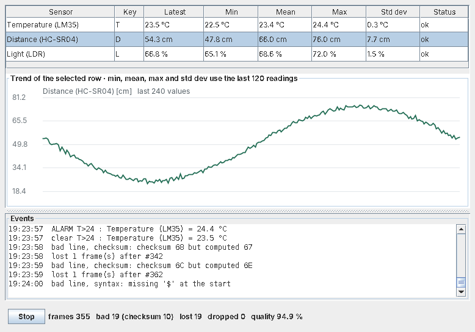
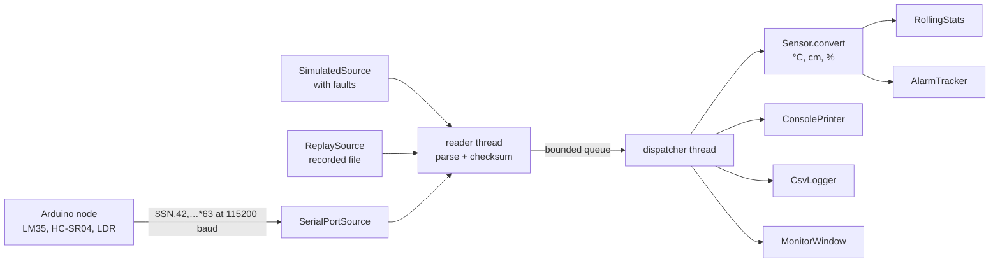

# Java Serial Monitor

[](https://github.com/HannaBeshoy/java-serial-monitor/actions/workflows/ci.yml)

**Programming Languages 2 course project** · University of Debrecen, Faculty of Informatics · Java 21 · Maven · Swing · Arduino

A desktop program that reads a sensor node (Arduino with an LM35 temperature sensor, an HC-SR04 ultrasonic distance sensor and an LDR) over a serial port. It checks every line with a checksum, detects lost frames from the sequence numbers, converts the raw values into °C, cm and %, keeps rolling statistics, raises alarms with hysteresis, writes a CSV log and shows a live window. A simulated node with fault injection lets everything run and be tested without hardware.

- [x] Line protocol with XOR checksum, parser and formatter ([protocol](docs/PROTOCOL.md))
- [x] Reader and dispatcher threads with a bounded queue, never blocking a live port
- [x] Statistics, alarms, CSV log, console output and a Swing window with a trend plot
- [x] **46 JUnit tests pass**, all with simulated or recorded data
- [x] Arduino sketch written; its output is checked by replaying it through the parser
- [ ] Tested with the real Arduino and sensors (planned for the lab day, December 2026)



## How it works



1. A **`DataSource`** delivers text lines. The real one uses the serial port (jSerialComm); the simulated and replay sources make the program testable without hardware.
2. The **reader thread** parses each line with **`FrameCodec`** and puts the result in a bounded queue. For a live port it never waits: if the PC falls behind, frames are counted as *dropped* instead of letting the port's buffer overflow. For files and fast simulations it waits for space instead.
3. The **dispatcher thread** compares sequence numbers to count *lost* frames, converts each raw value with its **`Sensor`** subclass, updates the statistics and alarms, and calls every **`MonitorListener`**.
4. Listeners print, log or draw. A listener that throws is reported once and the others keep running.

## Running it

Requires JDK 21 and Maven (or open the folder in IntelliJ IDEA, which imports the `pom.xml`).

```bash
mvn package                                   # builds and runs the tests
java -jar target/java-serial-monitor-1.0.0.jar --sim --faults --alarm "T>30" --alarm "D<20"
java -jar target/java-serial-monitor-1.0.0.jar --sim --gui --faults          # live window, endless
java -jar target/java-serial-monitor-1.0.0.jar --replay docs/sample-lines.txt
java -jar target/java-serial-monitor-1.0.0.jar --list-ports
java -jar target/java-serial-monitor-1.0.0.jar --port COM3 --gui --log run.csv   # the real node
```

Part of a run on simulated data with faults ([full output](docs/sample-output.txt)):

```text
reading from simulation (16 lines), alarms [T>23.6]
#0      T 23.9 °C    D 50.8 cm    L 59.6 %
  ALARM T>23.6 : Temperature (LM35) = 23.9 °C
#7      T 23.5 °C    D invalid    L 59.4 %
#8      T 23.5 °C    D 55.2 cm    L 60.4 %
  bad line (CHECKSUM): checksum 58 but computed 21
  lost 1 frame(s) after #8
#10     T 23.5 °C    D 55.0 cm    L 60.0 %

summary: lines 16, frames 15, bad 1 (checksum 1), lost 1, dropped 0, unknown keys 0, quality 93.8 %
  Temperature (LM35)   min   22.97  mean   23.49  max   23.95  sd  0.33 °C  (last 15 of 15)
```

`D invalid` is an ultrasonic timeout (no echo). The damaged frame #9 fails its checksum, so it is rejected and also shows up as lost. Temperatures move in steps of 0.49 °C because that is one step of a 10-bit ADC with a 5 V reference on an LM35 (5 V / 1023 / 10 mV per °C).

All options: `--help`. The CSV log has one row per reading, bad line and alarm ([sample](docs/sample-log.csv)).

## The sensor node

[`arduino/sensor_node/sensor_node.ino`](arduino/sensor_node/sensor_node.ino) sends raw values four times per second; the PC does the conversions, so they can be changed and tested without reflashing.

| Sensor | Pin | Sent as | Converted in Java |
| --- | --- | --- | --- |
| LM35 temperature | A0 | ADC counts 0–1023 | °C = counts · 5 / 1023 · 100 |
| HC-SR04 distance | Trig D9, Echo D10 | echo time in µs, 0 = no echo | cm = µs · 0.0343 / 2 |
| LDR light (with 10 kΩ divider) | A1 | ADC counts 0–1023 | % = counts · 100 / 1023 |

## Tests

```bash
mvn test
```

| Test class | What it checks |
| --- | --- |
| `FrameCodecTest` | checksum values, round trip, CR/LF and spaces, every syntax, checksum and field error |
| `SensorTest` | each conversion against hand calculations, ranges, timeouts, the registry |
| `StatsTest` | rolling window, mean and standard deviation, alarm rules, hysteresis |
| `SimulatedSourceTest` | same seed gives the same lines, fault rates, close, replay |
| `MonitorTest` | every line counted once, lost-frame detection, node restart, alarms end to end, unknown keys, fast stop, dropping under load without false "lost" counts, failing listeners, I/O errors |
| `CsvLoggerTest` | RFC 4180 escaping, one row per event, folder creation |
| `MainTest` | every option, bad input, a full console run, a missing file |

## What the course topics became

| Course topic | Where in the code |
| --- | --- |
| Classes, encapsulation, constructors, validation | `Sensor`, `RollingStats`, `Options` |
| Enums with behaviour, switch expressions | `AlarmRule.Op`, `FrameException.Kind`, `Options.parse` |
| Interfaces, programming to the interface | `DataSource`, `MonitorListener` (default methods) |
| Inheritance, abstract classes, dynamic binding | `Sensor` and its three subclasses |
| Records, immutability, sealed types, pattern matching | `Frame`, `Reading`, `MonitorStats`, the queue events in `Monitor` |
| Nested, inner and anonymous classes | `MonitorWindow.SensorTableModel`, the window listener, test sources |
| Checked exceptions, chaining, try-with-resources | `FrameException`, `CsvLogger`, `Main.run` |
| Event handling | listener pattern in `Monitor`, Swing `ActionListener`, `Timer` |
| Concurrency | reader and dispatcher threads, `BlockingQueue`, atomics, `CountDownLatch`, `synchronized` stats, the Swing event thread |
| Lambdas and streams | statistics in `RollingStats`, listener calls, the trend plot |
| `Comparable`, `Comparator`, sorting by several criteria | `AlarmHistory.Entry`: most severe alarm first, then earliest, then by key; `BY_TIME` as a second order; the end-of-run alarm summary |
| `equals` and `hashCode` | `Sensor` (class, key, unit, range) and `Lm35TemperatureSensor` (adds its reference voltage) |
| Files | CSV output, replay input |

The [project guide](docs/PROJECT_GUIDE.md) explains each design choice.

## Repository layout

```text
src/main/java/io/github/hannabeshoy/serialmonitor/
  protocol/   Frame, FrameCodec, FrameException
  sensor/     Sensor and its subclasses, Reading, SensorRegistry
  source/     DataSource, SerialPortSource, SimulatedSource, ReplaySource
  core/       Monitor, MonitorListener, MonitorStats
  stats/      RollingStats, AlarmRule, AlarmTracker
  log/        CsvLogger
  ui/         MonitorWindow, TrendPanel
  app/        Main, Options, ConsolePrinter
src/test/java/...   JUnit 4 tests
arduino/sensor_node/  the Arduino sketch
docs/               protocol, project guide, screenshot, sample output, log and recording
```

## Status and next steps

Verified in simulation and with recorded data. Hardware test with an Arduino Uno, LM35, HC-SR04 and LDR is planned for the lab day in December 2026; this README will then report the results. Possible next steps: a command channel back to the node (change the period), a binary protocol with CRC-16, and plotting several sensors at once.

## Author

Beshoy Hanna · Computer Science Engineering BSc, University of Debrecen · [LinkedIn](https://www.linkedin.com/in/beshoy-hanna-8b52213a0)
